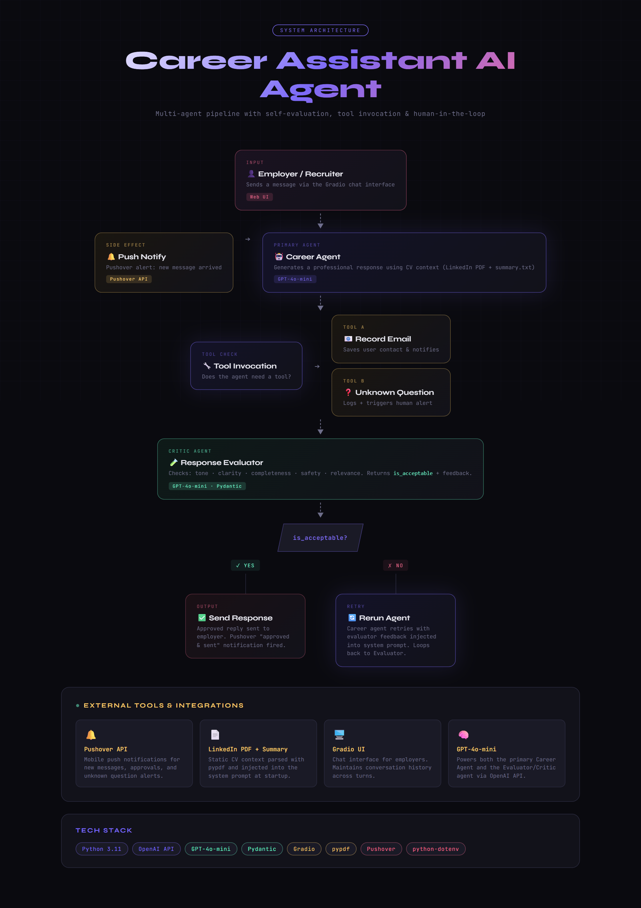

<div align="center">

# 🧭 Career Assistant AI Agent

**An AI agent that represents me to recruiters: it answers from my CV, grades its own replies, and escalates to me when it can't.**


</div>

## How it works

| Stage | Agent | What happens |
|---|---|---|
| 1 | **Career Agent** | Answers as me, grounded in my LinkedIn PDF + summary |
| 2 | **Tool calls** | `record_user_details` saves a recruiter's email; `record_unknown_question` flags what it can't answer |
| 3 | **Evaluator (critic)** | A second LLM checks tone, clarity, completeness, safety, relevance and returns a structured `Evaluation` (Pydantic) |
| 4 | **Retry loop** | Rejected replies are regenerated with the critic's feedback injected into the prompt |
| 5 | **Human-in-the-loop** | Push notifications (Pushover) alert me to new messages and unanswered questions |

<div align="center">

</div>

## Run it

```bash
git clone https://github.com/tahircan2/Career-Assistant-AI-Agent.git && cd Career-Assistant-AI-Agent
python -m venv .venv && source .venv/bin/activate     # Windows: .venv\Scripts\activate
pip install -r requirements.txt
cp .env.example .env                                   # add your keys
python career_assistant_ai_agent.py                    # opens the Gradio chat
```

Replace `me/linkedin.pdf` and `me/summary.txt` with your own to build your own agent.

## Docs

[Setup guide](docs/SETUP.md) · [Report](docs/Report.docx) · [Test cases](docs/Test_Cases.docx)
